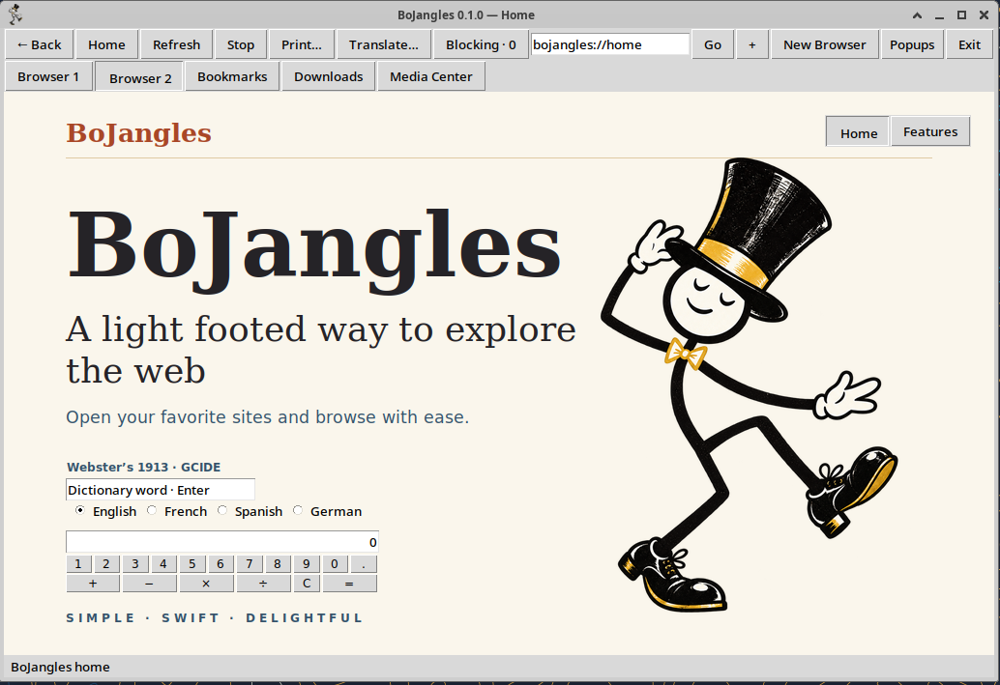

# BoJangles



## Command control sheet

[Download the approved BoJangles Command Control Sheet](BoJangles-Final-Command-Sheet-2026-10-28.docx)

BoJangles is a Linux Internet browsing suite with a native browser, crawler, independently controlled media windows and Media Center Library. Media workflows include recording, translation and transcription; optional models are obtained separately.

## First release

[Download release v0.1.0](https://github.com/EndUserOnly/BoJangles/releases/tag/v0.1.0)

- [Linux x86-64 package](https://github.com/EndUserOnly/BoJangles/releases/download/v0.1.0/BoJangles-0.1.0-linux-x86_64.tar.gz)
- [Complete corresponding source and build instructions](https://github.com/EndUserOnly/BoJangles/releases/download/v0.1.0/BoJangles-0.1.0-source.tar.gz)
- [SHA-256 checksums](SHA256SUMS.txt)

Use the **BoJangles-0.1.0-source.tar.gz** release asset for the complete application, maintained engine source, build scripts and notices. GitHub's automatically generated source archives contain this control repository, not that complete source distribution.

The qualified platform is Ubuntu 24.04-compatible Linux x86-64 with maintained WPE WebKit 2.54.2. Tk is the default frontend; GTK remains a preview. HTML5 profile is LIMITED. Preserve the complete application and matching engine bundle. No developer home, private profiles, credentials, recordings or models are included.

## Install

Verify the downloaded archives against SHA256SUMS.txt, then extract the Linux package and run:

```sh
python3 public-release-20261028/install-public-release.py public-release-20261028 --sha256 2490e5d9daf89396a566fea2ddb4f69487e98de48ea65a4ce202c04f144de0cf
bojangles open
```

The installer verifies the whole inventory, retains the predecessor, and does not start services or restart existing sessions. Open a fresh instance to use newly installed code.

## Verification

The owner cleared this exact compile for publication. Four-job compilation completed; 113 qualification executions, two installer checks and five production/native policy checks passed. The installed maintenance check passed 144 blocking probes with no failures. Actual compiled Library rename/error/retry/content-preservation checks passed. The complete reconstructed engine source has 26 authenticated maintained inputs and no unexplained differences against 39,104 retained source inputs apart from the declared override.

Executable SHA-256: `f502f0faf405fe9ad41f237057f08886e152ae0daa84c9849bdef8a4f0580764`.

The unchanged qualified WebKit library is retained; no fresh whole-WebKit or byte-reproducible clean-machine engine compilation is claimed. This is scoped technical qualification, not a universal website/media/printer or unknown-vulnerability guarantee. Build-time pending-owner status in the archive is superseded by the owner's subsequent publication approval recorded with the release.

## License

Original BoJangles code is **GPL-3.0-or-later**. See [LICENSE](LICENSE) and [LICENSING.md](LICENSING.md). Third-party components retain their own licenses and notices.

Brought to you from the creators of torrent-get:

- Teop Versant — Design Engineer
- Ness — Design and coding
